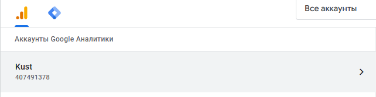
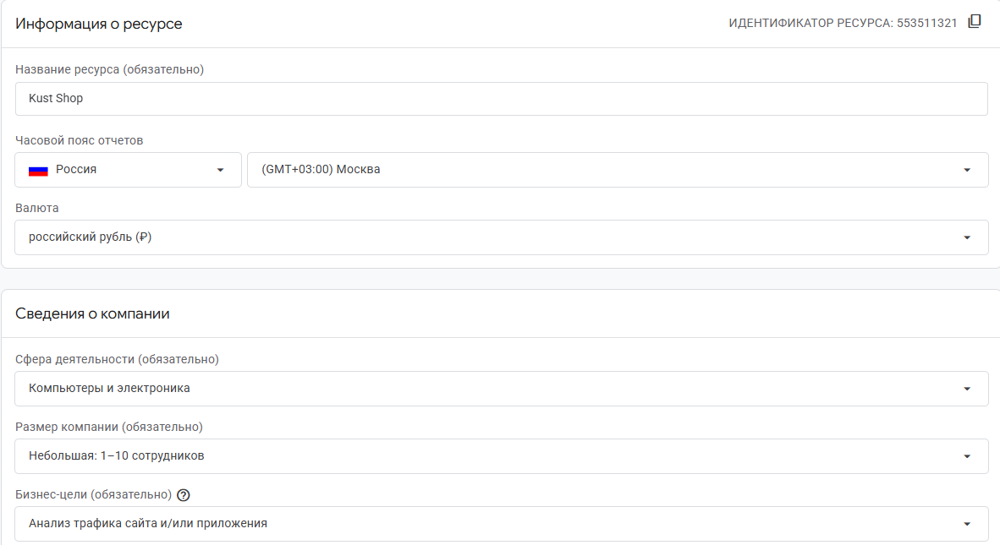
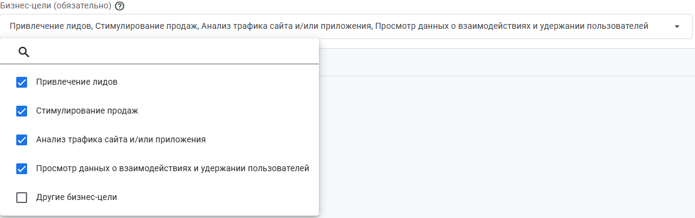
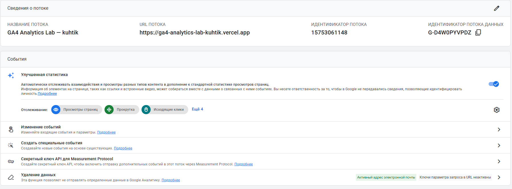
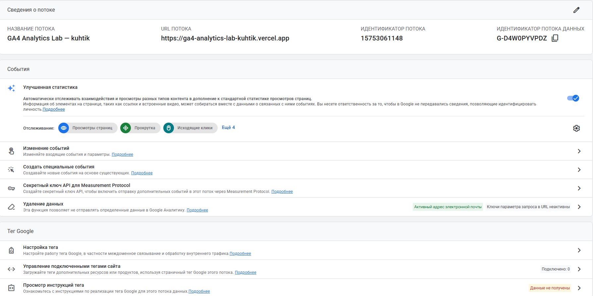

# Домашняя работа № 2 · Где бизнес теряет клиентов

**Дисциплина:** ОП.03 «Информационные технологии»

| Поле | Значение |
|---|---|
| Фамилия, имя, отчество | Кухтик Вадим Витальевич |
| Группа | 11/1 РПО |
| Номер работы | 2 |
| Тема работы | Анализ воронки цифрового продукта и структура Google Analytics 4 |

---

# Часть 1. Исследование воронки

## 1.1. Объект исследования

| Поле | Значение |
|---|---|
| Компания, сервис или отрасль | «М.Видео» — российский интернет-магазин техники |
| Адрес сайта или приложения |https://www.mvideo.ru/ |
| Целевое действие | Покупка товара на сайте |
| Почему выбран этот объект | у магазина легкий путь покупателя. На примерах интеренет-магазинов можно разобрать где покупатели могут уходить и что можно улучшить. |

## 1.2. Воронка

От 4 до 7 этапов, по порядку.

| № | Этап | Что считается переходом дальше | Метрика этапа |
|---|---|---|---|
| 1 | Переход на сайт | Человек нажал на рекламу или ссылку и открыл сайт | Количество переходов, CTR |
| 2 | Поиск товара | Человек выбрал категорию или воспользовался поиском | Доля переходов в каталог |
| 3 | Просмотр товара | Человек открыл страницу смартфона, ноутбука или другой техники | Количество просмотров карточек |
| 4 | Добавление в корзину | Человек нажал «В корзину» | Конверсия в добавление в корзину |
| 5 | Оформление заказа | Человек заполнил данные и выбрал доставку или самовывоз | Доля начатых оформлений, которые завершились заказом |
| 6 | Покупка | Заказ успешно оформлен и оплачен, если нужна онлайн-оплата | Количество покупок, конверсия в покупку |

## 1.3. Источники

Не менее пяти. Каждый разбирается по пяти пунктам.

### Источник 1

| Поле | Значение |
|---|---|
| Название материала | «Редизайн интернет-магазина МТС» |
| Автор или организация | AIC, публикация на сайте «Тэглайн» |
| Дата публикации | На странице не указана |
| Прямая ссылка | https://tagline.ru/aic/cases/redizayn-internet-magazina-mts/ |

**Выписка из материала** (ключевая мысль, цифра, наблюдение, результат):

>В кейсе описывается обновление интернет-магазина МТС: компания изменила меню и структуру сайта, чтобы покупателям было проще находить товары. В опубликованных результатах указано, что конверсия добавления товара в корзину из списка товаров выросла на 14%.

**Что подтверждает и как связано с моей воронкой** (своими словами):

>пример показывает, что покупателю важно быстро найти нужный товар. Если интерфейс запутан и непонятен, пользователь может выключить сайт, так и не найдя карточки товара. Это относится ко 2 и 3 этапу моей воронки

**Цифры из источника и этап воронки, к которому относятся:**

>+14% — рост конверсии добавления товара в корзину из списка товаров (этапы 3–4).

>+15% — изменение конверсии мобильной главной страницы (этап 2).

>В источнике не приведены исходные значения конверсии, поэтому нельзя определить разницу в процентных пунктах.

### Источник 2

| Поле | Значение |
|---|---|
| Название материала | Увеличили конверсию карточки товара интернет-магазина в 3,1 раза |
| Автор или организация | Intensa, публикация на сайте «Рейтинг Рунета» |
| Дата публикации | 7 декабря 2023 года |
| Прямая ссылка |https://ratingruneta.ru/cases/case-12707/ |

**Выписка из материала:**

>В интернет-магазине Kanzler обновили страницы товаров. До этого карточки медленно загружались, а на телефонах было неудобно пользоваться некоторыми функциями. После изменений конверсия карточки товара выросла в 3,1 раза.

**Что подтверждает и как связано с моей воронкой:**

>Даже если человеку понравился товар, он может не купить его, если страница работает медленно или нужную информацию сложно найти. В магазине технити важна доступность и удобство интерфейса. Пример относится ко 3-4 этапам воронки

**Цифры из источника и этап воронки:**

>В 3,1 раза — рост конверсии карточки товара после изменений (этап 4).
>Результат оценивали спустя два месяца после обновления.
>Исходное значение конверсии в публикации не указано.

### Источник 3

| Поле | Значение |
|---|---|
| Название материала | Как увеличить конверсию интернет-магазина в 2,6 раза: кейс по переработке карточки товара |
| Автор или организация | Директ Лайн, публикация на сайте «Рейтинг Рунета» |
| Дата публикации | 24 января 2020 года |
| Прямая ссылка | https://ratingruneta.ru/cases/case-7166/ |

**Выписка из материала:**

>В интернет-магазине «Форнакс» покупатели редко переходили в отдельный раздел с акциями. Поэтому информацию об акциях и доставке разместили прямо на странице товара. После изменений конверсия добавления товара в корзину выросла с 1,69% до 2,25% по всем городам

**Что подтверждает и как связано с моей воронкой:**

>Покупатель может не заметить скидку или не захотеть искать условия доставки на другой странице. Если показать эту информацию рядом с товаром, ему будет проще принять решение. В магазине "М.Видео" похожим образом можно проверить, насколько заметны условия доставки, самовывоза и скидки. Пример относится к просмотру товара и добавлению в корзину.

**Цифры из источника и этап воронки:**

>2% — доля посетителей каталога, которые переходили в раздел акций до изменений (этап 3).
>С 1,69% до 2,25% — конверсия добавления в корзину после изменений (этапы 3–4).

### Источник 4

| Поле | Значение |
|---|---|
| Название материала | «Воронки» |
| Автор или организация |Яндекс, справка Яндекс Метрики |
| Дата публикации | На странице не указана |
| Прямая ссылка | https://yandex.ru/support/metrica/ru/reports/funnels |

**Выписка из материала:**

>Отчёт «Воронка» помогает увидеть, как люди проходят шаги на сайте, и определить, на каком шаге часть пользователей перестаёт двигаться дальше.

**Что подтверждает и как связано с моей воронкой:**

>С помощью такого отчёта магазин может проверить, сколько людей открыли товар, сколько добавили его в корзину и сколько в итоге оформили заказ. Если на каком-то шаге людей становится намного меньше, этот этап нужно изучить подробнее.

**Цифры из источника и этап воронки:**

>Источник описывает возможности отчёта, а не результаты конкретного интернет-магазина. Числовых показателей конверсии «М.Видео» в нём нет.

### Источник 5

| Поле | Значение |
|---|---|
| Название материала | «[GA4] Исследование воронки» |
| Автор или организация | Google Analytics Help |
| Дата публикации | На странице не указана |
| Прямая ссылка | https://support.google.com/analytics/answer/9327974 |

**Выписка из материала:**

>Исследование воронки в Google Analytics позволяет посмотреть, какие шаги проходят пользователи и на каком шаге они прекращают путь.

**Что подтверждает и как связано с моей воронкой:**

>Этот инструмент можно использовать, чтобы отслеживать путь покупателя от просмотра товара до покупки.

**Цифры из источника и этап воронки:**

>Источник описывает возможности аналитики. Конкретные показатели интернет-магазина «М.Видео» в нём не приведены.

## 1.4. Реальные кейсы

Не менее двух, российские компании или российский рынок. Каждый разбирается по семи
пунктам. Если показатели не опубликованы, пишется: «точные показатели
в открытом источнике не приведены».

### Кейс 1

| № | Пункт | Ответ |
|---|---|---|
| 1 | Компания, продукт или рынок | МТС — российский интернет-магазин техники и электроники. |
| 2 | Как выглядела воронка или её проблемный участок | Покупатель заходил на сайт, искал товар, открывал его страницу и добавлял в корзину. Одной из задач было сделать поиск товаров проще и увеличить количество добавлений в корзину. |
| 3 | В чём заключалась проблема | Пользователю могло быть трудно найти нужную категорию из-за структуры меню. Если человек долго ищет нужный товар, он может уйти на другой сайт. |
| 4 | Какие данные или наблюдения подтвердили проблему | В кейсе описаны изучение структуры меню и анализ поведения пользователей. После обновления сайта компания опубликовала рост конверсии главной страницы и добавления товара в корзину. |
| 5 | Что изменили или протестировали | Изменили меню и названия его разделов, обновили структуру сайта и адаптировали дизайн под разные устройства. |
| 6 | Как изменился результат | В опубликованных данных указано, что конверсия добавления товара в корзину из списка товаров выросла на 14%, а конверсия мобильной главной страницы — на 15%. Исходные значения не указаны. |
| 7 | Переносим ли подход на мой объект | Да. «М.Видео» тоже продаёт технику через интернет. Можно проверить, легко ли найти популярные категории и работает ли поиск так, как ожидают покупатели. |

**Ссылка на источник кейса:**

>https://tagline.ru/aic/cases/redizayn-internet-magazina-mts/

### Кейс 2

| № | Пункт | Ответ |
|---|---|---|
| 1 | Компания, продукт или рынок | Kanzler — российский интернет-магазин мужской одежды. |
| 2 | Как выглядела воронка или её проблемный участок | Покупатель открывал каталог, выбирал вещь, заходил в карточку товара и добавлял товар в корзину. Проблема была на странице товара. |
| 3 | В чём заключалась проблема | Страницы товаров медленно загружались, а на телефоне некоторые действия было неудобно выполнять. Покупателю было сложнее разобраться в размерах и оформить покупку. |
| 4 | Какие данные или наблюдения подтвердили проблему | Компания сравнила показатели до изменений и через два месяца после обновления сайта. В кейсе указано, что конверсия карточки товара выросла в 3,1 раза. |
| 5 | Что изменили или протестировали | Обновили внешний вид карточек, улучшили мобильную версию, сделали информацию о размерах понятнее и исправили ошибки на сайте. |
| 6 | Как изменился результат | В публикации заявлен рост конверсии карточки товара в 3,1 раза. Точные исходные значения конверсии не приведены. |
| 7 | Переносим ли подход на мой объект | Да. На сайте «М.Видео» тоже важно, чтобы страницы быстро открывались и покупатель сразу видел характеристики, цену и условия доставки. Можно проверить, чаще ли пользователи добавляют товар в корзину после упрощения карточки. |

**Ссылка на источник кейса:**

>https://ratingruneta.ru/cases/case-12707/

## 1.5. Причины потери пользователей

Не менее трёх. Каждая опирается на найденные материалы.

| № | Этап воронки | Причина потери | Какой источник это подтверждает |
|---|---|---|---|
| 1 | Этапы 2–3 | Человек не может быстро найти нужный товар и закрывает сайт. | Источник 1: в кейсе МТС меняли структуру меню, а после изменений выросли показатели конверсии. |
| 2 | Этап 3–4 | Страница товара медленно загружается или на ней сложно найти нужную информацию. Покупатель не добавляет товар в корзину. | Источник 2: в кейсе Kanzler обновили карточки товаров и улучшили мобильную версию; конверсия карточки выросла в 3,1 раза. |
| 3 | Этапы 3–4 | Покупатель не замечает скидку или условия доставки, потому что они находятся в другом разделе. | Источник 3: в кейсе «Форнакс» информацию об акциях и доставке разместили на странице товара, после чего выросла конверсия добавления в корзину. |
| 4 | Покупатель кладёт товар в корзину, но не заканчивает заказ. Возможные причины — сложное оформление или непонятные условия доставки. Это предположение, которое нужно проверить на данных магазина. | Источники 4 и 5: отчёты Яндекс Метрики и Google Analytics позволяют увидеть, на каком шаге пользователи прекращают путь. |

## 1.6. Гипотезы улучшения

Не менее трёх, собственные.

| № | Этап | Гипотеза | Какие данные нужно собрать | Как проверить, сработало |
|---|---|---|---|---|
| 1 | Этапы 2–3 | Если сделать меню проще и добавить более заметные ссылки на популярные категории, больше людей будут находить нужный товар. | Количество переходов в категории, поисковые запросы, просмотры карточек, данные отдельно по телефонам и компьютерам. | Сравнить старую и новую версии меню. Проверить, стало ли больше переходов в каталог и карточки товара. |
| 2 | Этап 3–4 | Если на странице товара понятнее показывать цену, характеристики, наличие и доставку, больше покупателей будут добавлять товар в корзину. | Просмотры карточек, добавления в корзину, скорость загрузки, клики по информации о доставке, тип устройства. | Обновить часть карточек и сравнить их с прежней версией. Проверить, выросла ли доля добавлений в корзину. |
| 3 | Этапы 5–6 | Если упростить оформление заказа и заранее показать способы доставки и оплаты, больше людей будут завершать покупку. | Количество корзин, начало оформления, завершённые заказы, ошибки при заполнении формы, шаг, на котором люди уходят. | Сравнить показатели до и после изменений или провести тест двух вариантов оформления. Проверить, увеличилась ли доля завершённых заказов. |

---

# Часть 2. Google Analytics 4

## 2.1. Пройденные шаги

| № | Шаг | Выполнено |
|---|---|---|
| 1 | Вход в Google Analytics под своим аккаунтом | да |
| 2 | Создан Analytics Account | да |
| 3 | Создан Property | да |
| 4 | Выбраны часовой пояс, валюта и общие сведения | да |
| 5 | Выбраны бизнес-цели | да |
| 6 | Создан ресурс | да |
| 7 | Создан Web Data Stream | да |
| 8 | Проверены Website URL, Stream name, Enhanced Measurement | да |
| 9 | Поток создан | да |
| 10 | Найден Measurement ID | да |

## 2.2. Что получилось

| Поле | Значение |
|---|---|
| Analytics Account | 407491378 |
| Property | 553511321 |
| Reporting time zone | GTM + 03:00 |
| Currency | Rub |
| Выбранные бизнес-цели | Все галочки поставлены |
| Stream name | GA4 Analytics Lab — kuhtik |
| Website URL | https://ga4-analytics-lab-kuhtik.vercel.app/ |
| Stream ID (числовой) | 15753061148 |
| Measurement ID (`G-…`) | G-D4W0PYVPDZ |
| Enhanced Measurement | включено |

Stream ID и Measurement ID — это разные идентификаторы. На сайт в задании 3
ставится второй, вида `G-XXXXXXXXXX`.

## 2.3. Скриншоты

`

`

`

`

`

---

## Использование ИИ

Источники вы ищете, читаете и проверяете сами, настройку проходите тоже
сами. ИИ допускается для поиска идей, структурирования и проверки
формулировок, но источником он не считается.

| Вопрос | Ответ |
|---|---|
| Что сделано самостоятельно | Идеи и мысли мои. К ии обратился за помощью в оформлении и коректировки мыслей |
| Что спрошено у модели |  |
| Что после этого проверено и изменено |  |
