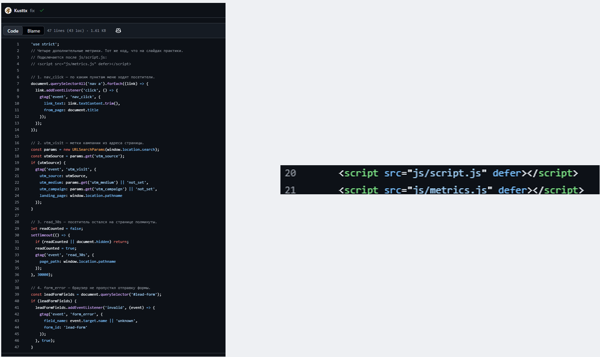

# Домашняя работа № 4 · Свои события и параметры в GA4

**Дисциплина:** ОП.03 «Информационные технологии»

| Поле | Значение |
|---|---|
| Фамилия, имя, отчество | Кухтик Вадим Витальевич |
| Группа | 11/1 РПО |
| Номер работы | 4 |
| Тема работы | Свои события и параметры: четыре метрики на сайте |

---

## 1. Мой сайт и мой ресурс

| Поле | Значение |
|---|---|
| Публичный адрес сайта | https://ga4-analytics-lab-kuhtik.vercel.app/ |
| Measurement ID (`G-…`) | G-D4W0PYVPDZ |
| Коммит с метриками (ссылка или первые 7 символов) | https://github.com/Kusttx/ga4-analytics-lab-kuhtik/commit/8d8efb7bf68d5cb227047479384b6af38c928bfe |
| Статус публикации | READY |
| Страницы, где подключён `js/metrics.js` | index.html, about.html, contacts.html |

Файл подключается после основного скрипта и на каждой странице по одному
разу: два подключения дают двойные события.

## 2. Какие метрики добавлены

| Событие | Что измеряет | Что делали, чтобы оно сработало |
|---|---|---|
| `nav_click` | клики по пунктам меню | Событие появилось в Tag Assistant после перехода по пункту меню. |
| `utm_visit` | метки кампании из адреса | Открыта тестовая ссылка; в Network подтверждены событие и параметры utm_source=test, utm_medium=debug, utm_campaign=lesson6, landing_page=/. |
| `read_30s` | полминуты на странице | В Network найден запрос GA4 с параметром en=read_30s. |
| `form_error` | форма не прошла проверку браузера | В отладке подтверждено событие form_error с field_name=email и form_id=lead-form. |

`

## 3. События в DebugView

| Поле | Значение |
|---|---|
| Дата и время проверки | 28.10 19:00 |
| Как подключали отладку | Tag Assistant |
| Какие из четырёх событий пришли | nav_click, utm_visit, read_30s, form_error — каждое подтверждено предоставленными скриншотами в соответствующем инструменте. |
| Какие не пришли и почему | На момент подготовки отчёта не выявлено подтверждённого отказа по этим четырём событиям. |

Скриншот: вставьте строку ``

## 4. Параметры события `utm_visit`

**Ссылка, по которой открывали сайт:**

```
https://ga4-analytics-lab-kuhtik.vercel.app/?utm_source=test&utm_medium=debug&utm_campaign=lesson6

```

| Параметр | Значение в ссылке | Значение в GA4 |
|---|---|---|
| `utm_source` | test | test |
| `utm_medium` | debug | debug |
| `utm_campaign` | lesson6 | lesson6 |
| `landing_page` | — | / |

Скриншот: вставьте строку ``

## 5. Событие вне отладки

| Поле | Значение |
|---|---|
| Где проверяли | Realtime / Отчёты → обзор в режиме реального времени |
| Какое событие искали | utm_visit |
| Сколько срабатываний показал экран | 6 |
| Период (для отчёта) | последние 30 минут |

Скриншот: вставьте строку ``

## 6. Что эти метрики показывают про сайт

Два-три предложения: что вы узнали о поведении посетителей из четырёх
новых событий. Например, по каким пунктам меню ходят чаще, доходит ли
кто-то до получаса чтения, спотыкается ли форма.

>По событиям видно, что посетители нажимают на кнопки и ссылки, читают страницы и заходят на сайт по UTM-меткам. Также можно проверить, возникают ли ошибки при заполнении формы.

## 7. Что не получилось

Если какая-то метрика не заработала, напишите какая, что показывал экран
и что было проверено по таблице из `README.md`. Незаполненный раздел
означает, что всё получилось.

>

## 8. Использование ИИ

Скрипты метрик выданы готовыми. Подключение, проверку и кадры вы делаете
сами. ИИ допускается для формулировок и оформления.

| Вопрос | Ответ |
|---|---|
| Что сделано самостоятельно | формулировки и фотошоп |
| Что спрошено у модели | соединение скринов и попрвка оформление |
| Что после этого изменено |  |
